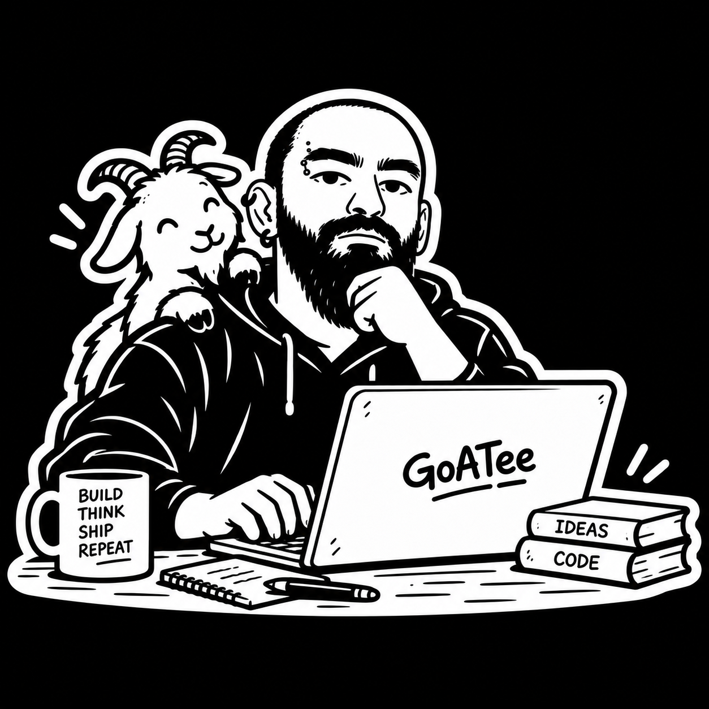

# GoATee

<p align="center">
  
</p>

<p align="center">
  <strong>Agree exactly. Build minimally. Prove delivery.</strong>
</p>

<p align="center">
  A lightweight control layer for AI-assisted software changes.
</p>

---

You tell an AI coding agent:

> Add CSV export to the customer report.

It starts building.

A few minutes later:

- six files changed
- a new package appeared
- an existing utility was rewritten
- something outside the request got refactored
- the agent says everything works

Maybe all of that was necessary.

Maybe none of it was.

The problem is that the agreement was never explicit.

## GoATee starts there.

Before implementation, GoATee helps establish:

```text
What are we actually changing?

What counts as done?

What should remain untouched?

What is the smallest reasonable implementation?

How will we prove delivery?
```

Then the coding agent can build.

GoATee keeps the contract.

---

## What GoATee is

GoATee is a **spec and delivery control layer** around coding assistants such as Claude Code, Codex, Gemini, Cursor, or other CLI agents.

It is designed primarily for:

* Forward Deployed Consultants
* technical product owners
* solution consultants
* AI-native builders
* non-developers directing coding agents

GoATee does **not** try to become another coding agent.

The agent reasons and writes code.

GoATee keeps track of what was agreed.

```text
HUMAN INTENT
     │
     ▼
AGREEMENT
     │
     ▼
AGENT INSPECTS REPOSITORY
     │
     ▼
PROPOSED BUILD BUDGET
     │
     ▼
HUMAN APPROVAL
     │
     ▼
BASELINE LOCKED
     │
     ▼
AI IMPLEMENTS
     │
     ▼
EVIDENCE
     │
     ▼
DELIVERY
```

---

## The three questions

Everything in GoATee exists to answer three questions.

### 1. What exactly did we agree to build?

The change contract records:

* intent
* scope
* exclusions
* acceptance criteria
* evidence requirements

### 2. How little should we build?

The coding agent inspects the repository and proposes a **Build Budget**:

* expected change surface
* existing components to reuse
* dependency policy
* protected areas
* likely blast radius

The human approves it before implementation.

Minimal does not mean code golf.

It means **proportionate to the problem**.

### 3. Can we prove what was delivered?

GoATee is being built to compare:

```text
AGREED STATE
     ↓
ACTUAL CHANGE
     ↓
OBSERVED EVIDENCE
```

The end goal is a delivery receipt grounded in repository state, tests, observations, and explicit deviations.

Not:

> "The agent said it works."

---

## The I-7 Operating Model

Behind GoATee's triad is the **I-7 Operating Model**—GoATee's human-centered change-control loop preventing AI coding agents from jumping from a vague request directly into unbounded implementation:

```text
AGREE EXACTLY
  I-1 Intent     What are we actually trying to accomplish? (Business/user need)
  I-2 Inform     What context, repo structure, and OSS exist? (Reality inspection)
  I-3 Interpret  What are in/out-of-scope and the exact acceptance criteria?

BUILD MINIMALLY
  I-4 Initiate   Agent inspects repository and proposes the technical Build Budget
  I-5 Inspect    HARD HUMAN GATE: Review & approve budget -> lock baseline commit
  I-6 Intervene  Agent implements strictly within approved boundary; deviations loop back to I-5

PROVE DELIVERY
  I-7 Iterate    Verify declared evidence against actual diff & test results -> delivery receipt
```

---

## The artifact model

GoATee deliberately keeps its persistent state small.

```text
.goatee/
├── project.md
└── changes/
    └── <change-id>/
        ├── change.md
        ├── receipt.md
        └── review.md   # when human attestation exists
```

### `project.md`

Long-lived project rules.

```text
stack
verification commands
dependency policy
permanent constraints
```

### `change.md`

The governing agreement for one software change.

```text
intent
scope
acceptance criteria
build budget
approval state
baseline commit
```

### `receipt.md`

The machine-generated evidence snapshot.

```text
verified commit
coverage matrix
surface deviations
git mutations
machine verdict
```

### `review.md`

The receipt-bound attributed human review (when human attestation exists).

```text
receipt binding (commit & SHA-256)
attestation coverage matrix
dual-verdict resolution
append-preserving event history
Git-configured reviewer attribution
```

---

## Current status

GoATee is under active development.

### v0.1 Foundation ✓

* **Phase 1**: Base foundation (`goatee init`, `goatee new <change-id>`, `goatee approve <change-id>`).
* **Phase 2**: Bounded handoff & budget comparison (`goatee handoff <change-id>`).
* **Phase 3**: Deterministic verification & machine delivery receipts (`goatee verify <change-id>`).

### v0.2 Hardening, Inspection & Attestation ✓

* **004 — Proof Hardening**: Control-plane integrity safeguards, Git HEAD invariant enforcement, mutation halting, execution timeouts, DEVNULL stdin isolation, and rename-aware budget diffs.
* **005 — Control Status**: Read-only control status (`goatee status`, `goatee status <change-id>`), separate contract/machine states, candidate vs. verified commit distinction, and working-tree cleanliness visibility without side effects.
* **006 — Human Attestation**: Deterministic human attestation engine (`goatee attest`), receipt-bound review records (`review.md`), dual-verdict verification (`Machine Verdict` and `Human Review`), and Git-configured reviewer attribution without modifying historical machine receipts.
* **007 — Release Prep**: Release alignment and packaging.

### v0.3 Agent Bridge, Guardrails & Contract Integrity ✓

* **008 — Pre-flight & Agent Bridge**: Working tree pre-flight budget inspection (`goatee check`), interactive human attestation terminal wizard (`goatee attest -i`), active change auto-detection, and pure stdlib stdio MCP server (`goatee mcp`).
* **009 — Contract Integrity & Guardrails**: Cryptographic contract tamper detection (`Contract-SHA256`) eliminating the self-approving agent loophole, auditable human budget amendment protocol (`goatee amend`), zero-dependency Git pre-commit guardrail hook (`goatee hook install/uninstall`), and agent budget proposal via MCP (`goatee_propose_budget`).

Current test result:

```text
79 tests
79 passed
0 errors
```

### Release Statement

```text
GoATee v0.3 is released.
The control layer provides end-to-end agreement, bounded implementation, hardened machine proof, receipt-bound human attestation, cryptographic contract tamper protection, Git pre-commit guardrails, and seamless AI agent integration via stdio MCP.
```

---

## Install

GoATee currently requires Python 3.10 or newer.

```bash
git clone <goatee-repository>
cd GoATee

pip install -e .
```

No external runtime dependencies are required.

Check the CLI:

```bash
goatee --help
```

---

## Start a project

From inside an existing Git repository:

```bash
goatee init
```

This creates:

```text
.goatee/project.md
```

Use it to describe the project environment and permanent delivery constraints.

---

## Start a change

```bash
goatee new 001-export-csv
```

GoATee creates:

```text
.goatee/changes/001-export-csv/change.md
```

The human defines the business side first:

```markdown
## Intent

Allow users to export the currently filtered report as CSV.

## In Scope

- Export visible report data.
- Preserve active filters.

## Out of Scope

- Scheduled exports.
- PDF export.
- Changes to authentication.
```

Acceptance criteria are explicit:

```markdown
- AC-01: User can export filtered records as CSV.
  Evidence:
    type: automated
    command: pytest tests/test_export.py
    expected: exit 0

- AC-02: Export control appears beside Filters.
  Evidence:
    type: manual
    instruction: Confirm Export appears beside Filters.
```

---

## Let the agent inspect before it builds

The coding agent investigates the repository and proposes the technical boundary.

Example:

```markdown
## Build Budget

### Expected Surface

- src/export/
- tests/test_export.py

### Reuse Strategy

- Existing report filtering pipeline.
- Existing CSV utility.

Dependency-Policy: No new runtime dependencies

### Blast Radius

- src/auth/
- src/billing/
```

The important part:

**The non-developer does not need to guess the architecture.**

The agent proposes.

The human approves.

---

## Lock the agreement

Once both the agreement and Build Budget are approved:

```bash
goatee approve 001-export-csv
```

GoATee checks that:

* the repository is valid
* Git has an existing `HEAD`
* the agreement is approved
* the Build Budget is approved
* unrelated application changes are not already sitting in the workspace
* the change has not already been baselined

It then records:

```text
Baseline-Commit: <git-sha>
Contract-SHA256: <sha256-hash>
```

That baseline SHA and cryptographic contract hash lock the reference point and agreement boundary. Any subsequent unauthorized edits to the contract (such as an agent secretly expanding the Expected Surface) will cause verification to fail closed.

The build can now begin.

---

## Why the baseline matters

Without a baseline:

```text
"Here is what the agent changed."
```

is surprisingly hard to define.

With one:

```text
baseline commit
      │
      │ implementation
      ▼
delivered commit
```

GoATee can eventually evaluate the actual delivery using Git rather than relying on an agent's summary.

```bash
git diff <baseline>..<delivered>
```

Repository state becomes evidence.

---

## Pre-flight budget check

Before committing code or running verification, developers and coding agents can inspect uncommitted (staged and unstaged) working-tree modifications against the approved Build Budget:

```bash
# Check working tree against active change budget
goatee check

# Or specify a change explicitly
goatee check 001-export-csv
```

GoATee reports:
- files inside the `Expected Surface`
- unapproved `Surface Deviations`
- touches to protected `Blast Radius` paths

`goatee check` has zero side effects: it does not create `receipt.md` or mutate Git state. If unapproved deviations or protected changes are touched, it exits with returncode `1`.

---

## Git pre-commit guardrail hook

To prevent accidental commits that violate the approved Build Budget, GoATee can install an automatic Git pre-commit hook:

```bash
# Install zero-dependency pre-commit hook
goatee hook install

# Or remove it
goatee hook uninstall
```

Whenever `git commit` is invoked, the hook executes `goatee check` in the background. If unapproved surface deviations or protected blast-radius files are touched, the commit is blocked automatically.

---

## Amend the build budget

If implementation reveals that scope genuinely needs to expand (the I-6 -> I-5 loop), a human must explicitly approve the budget amendment:

```bash
goatee amend 001-export-csv --add-surface src/utils/csv_helper.py --note "Needed extra utility for CSV escaping"
```

GoATee records the new surface in `change.md`, logs the attribution and rationale in `## Amendments`, and re-computes `Contract-SHA256`. Agents cannot amend budgets; amendments require explicit human action.

---

## Inspect status

`goatee status` provides read-only visibility into the control plane without modifying repository state or files:

```bash
# Repo-wide overview of all changes
goatee status

# Detailed view for a specific change
goatee status 001-export-csv
```

Status reports the contract approval state, machine verification verdict, human review state, candidate commit, and whether the working tree is clean.

---

## Record human attestation

When a change contains manual acceptance criteria or requires human sign-off, `goatee attest` records human attestation into a separate, receipt-bound review artifact.

You can launch the interactive terminal wizard to step through pending criteria:

```bash
# Interactive wizard for active or specified change
goatee attest -i
# or
goatee attest 001-export-csv --interactive
```

Or attest individual criteria directly via CLI flags:

```bash
goatee attest 001-export-csv --criterion AC-02 --verified --note "Export button verified beside Filters"
```

Attestation requires an existing machine receipt (`receipt.md`). It creates or appends to `.goatee/changes/<change-id>/review.md` without modifying `receipt.md`. Reviewer identity is attributed from local Git configuration (`user.name` and `user.email`).

---

## Connect coding agents via MCP

GoATee includes a zero-dependency Model Context Protocol (MCP) server running over stdio, allowing AI coding assistants (such as Claude Code, Cursor, Windsurf, or Gemini CLI) to inspect boundaries autonomously:

```bash
goatee mcp
```

Exposed MCP tools:
- `goatee_get_contract`: Fetch governing change contract, intent, acceptance criteria, and build budget.
- `goatee_propose_budget`: Allow coding agents to draft/update the Build Budget section before human approval.
- `goatee_check_budget`: Pre-flight check on current working tree changes.
- `goatee_get_status`: Project overview or detailed change report.

---

## The dual-verdict model

GoATee v0.2 maintains strict separation between machine proof and human judgment:

* **Machine Verdict**: Deterministic output of automated command execution and budget diff checks (`PASS | NEEDS_REVIEW`).
* **Human Review**: Recorded human attestation events (`PENDING | ACCEPTED | REJECTED`).

`FAILED` is a criterion-level status (`VERIFIED`, `FAILED`, `NEEDS_REVIEW`, `NOT_RUN`), not an overall Machine Verdict.

The boundaries are absolute:

* Human review never rewrites the Machine Verdict.
* Human attestation never alters receipt rows or turns `NEEDS_REVIEW` into machine `VERIFIED`.
* Machine failure may block Human Review from becoming `ACCEPTED`.
* Machine failure does not manufacture `Human Review: REJECTED` (only an explicit human attestation event can reject).

Example dual-verdict state:

```text
Machine Verdict:  NEEDS_REVIEW
Human Review:     ACCEPTED
```

---

## Build the difference

GoATee itself follows the same principle it asks of coding agents:

> **Reuse intelligently. Build only what GoATee uniquely needs.**

The project learns from existing open-source work instead of rebuilding established ideas.

| Project         | GoATee learns from                                |
| --------------- | ------------------------------------------------- |
| GitHub Spec Kit | specification quality and ambiguity reduction     |
| OpenSpec        | change-oriented specification workflows           |
| Ponytail        | implementation restraint and reuse-first thinking |
| Liatrio SDD     | requirement-to-evidence mapping                   |
| BMAD Method     | right-sizing process to change complexity         |
| Git             | authoritative repository state and change history |

GoATee does not bundle these projects together.

It adapts useful primitives and builds the missing layer around them.

See [`THIRD_PARTY.md`](THIRD_PARTY.md) for exact provenance, versions, licenses, and adaptations.

---

## Five engineering principles

### BUILD THE DIFFERENCE

Search before creating.

### ARTIFACTS OVER ASSERTIONS

Repository state and evidence outrank agent narration.

### SPEC BEFORE IMPLEMENTATION

Material ambiguity is resolved before the build begins.

### PROPORTIONATE CHANGE

Change only what is necessary to satisfy the agreement safely.

### HUMAN OWNS DEVIATION

An AI can discover that scope needs to change.

It cannot silently redefine the agreement.

---

## What GoATee is not

GoATee v0.2 is intentionally narrow.

It is not:

* an AI coding model
* an agent swarm
* a model router
* an IDE
* a code editor
* an autonomous product manager
* a replacement for Git
* a heavyweight PRD framework
* an excuse to create more process

The goal is much smaller:

> Establish the agreement.
> Bound the implementation.
> Make delivery provable.

---

## Thesis

GoATee v0.2 is an experiment.

It needs to prove that someone who does not write production code can still answer:

```text
What did we agree to build?

What was the starting point?

What was the smallest reasonable implementation?

What actually changed?

Did we stay within the agreed boundary?

Can we prove the result?
```

If GoATee cannot make those answers clearer, it does not need more features.

It needs less.

---

## License

MIT.

See [`THIRD_PARTY.md`](THIRD_PARTY.md) for upstream attribution and open-source provenance.
